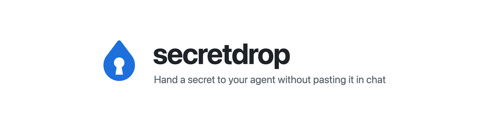
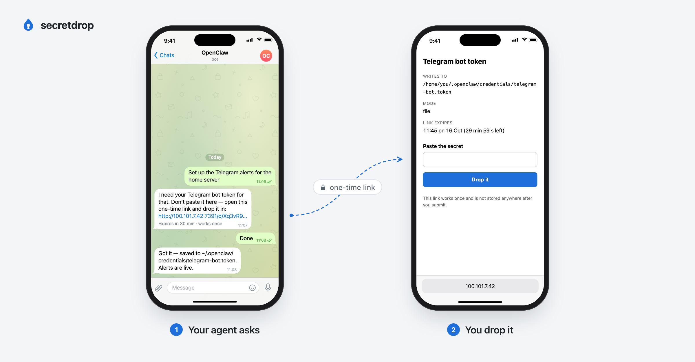

<p align="center">
  <picture>
    <source media="(prefers-color-scheme: dark)" srcset="docs/assets/banner-dark.png">
    
  </picture>
</p>

Your agent needs an API key. You could paste it into the chat, but then it lives in the transcript, the logs and every backup of them. secretdrop gives your agent a one-time link instead. You open it on your phone, paste the key, and it lands in a file on the agent's machine that only your user can read.

The link works once, expires in 30 minutes, and can only write to folders you approved. It travels over [Tailscale](https://tailscale.com), the private network that already connects your phone and your machines, so it is never on the public internet.

## Install

Install the skill for every agent you use, in one line:

```sh
npx skills add Rendiere/secretdrop
```

Or per host:

| Host | Command |
| --- | --- |
| Claude Code | `/plugin install secretdrop --marketplace Rendiere/secretdrop` |
| OpenClaw | `openclaw skills install @rendiere/secretdrop` |
| Codex | `npx skills add Rendiere/secretdrop -a codex -g` |

## Set it up

1. Install Tailscale on the machine your agent runs on and on your phone, signed in to the same account.
2. Install the skill with one of the commands above.
3. Paste this to your agent:

   > Set up secretdrop on this machine. Read the secretdrop skill and follow its setup steps.

4. Your agent installs secretdrop, shows you the folders it wants to be allowed to write secrets to, and waits for you to approve them.
5. It sends you a test link. Open it on your phone and submit any text. When the agent says it landed, you're done.

## How a drop works

<p align="center">
  
</p>

1. Your agent asks for a secret by sending you a link, with a label you'll recognise such as "Telegram bot token".
2. You open it on your phone. The page shows the label, the file it writes to and one box to paste into.
3. You paste and submit. secretdrop writes the file at mode 0600 and the link stops working.
4. Your agent carries on. On OpenClaw, the session that asked is woken as soon as the secret lands. Claude Code and Codex check until it does, because nothing can wake them.

## What it protects you from

- Secrets in chat history. The value never passes through the chat, a transcript or a log, and your agent only ever sees the file path.
- Replayed links. Each link works once and expires.
- An agent writing secrets where it shouldn't. Every destination is checked against the allowlist you approved, when the link is made and again when it is used.

It does not protect you from someone else on your Tailscale network who gets the link before you use it, or from anything already running as your user on that machine. The [full threat model](docs/reference.md#threat-model) has the detail.

## Commands

| Command | What it does |
| --- | --- |
| `secretdrop link --dest <file> --label <text>` | Make a one-time link that writes to `<file>` |
| `secretdrop wait <id>` | Wait until a link lands, fails, is revoked or expires |
| `secretdrop list` | Show links that are still waiting |
| `secretdrop revoke <id>` | Kill a link early |
| `secretdrop serve` | Run the server |

Configuration, callbacks, running it as a service and the tests are in the [reference](docs/reference.md).

## License

MIT
